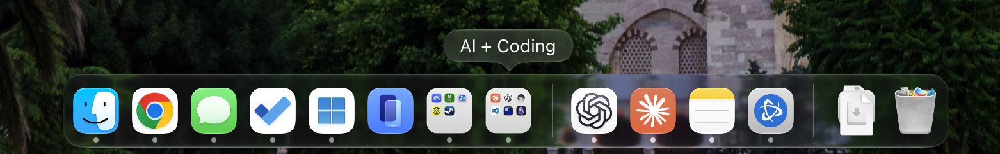
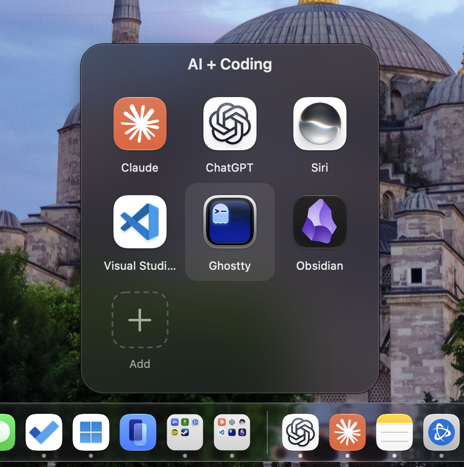
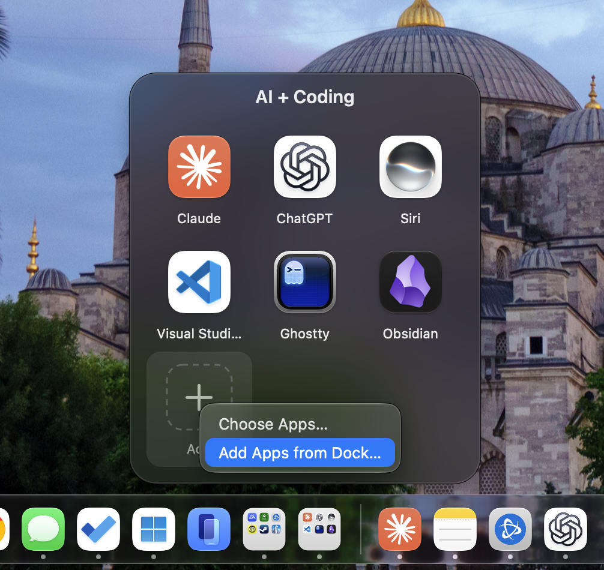
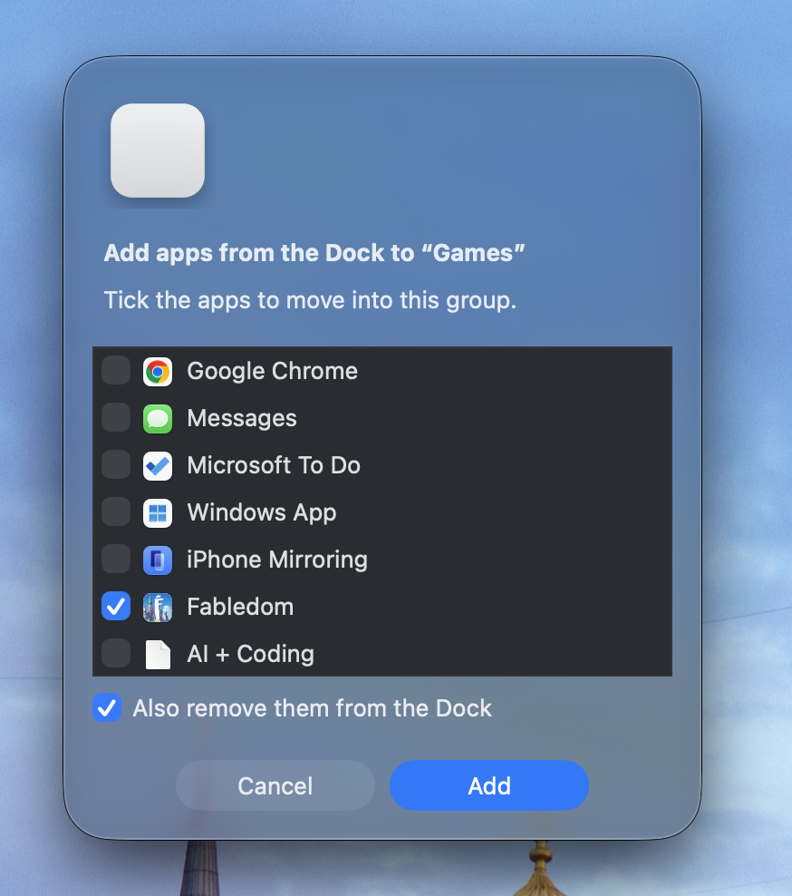
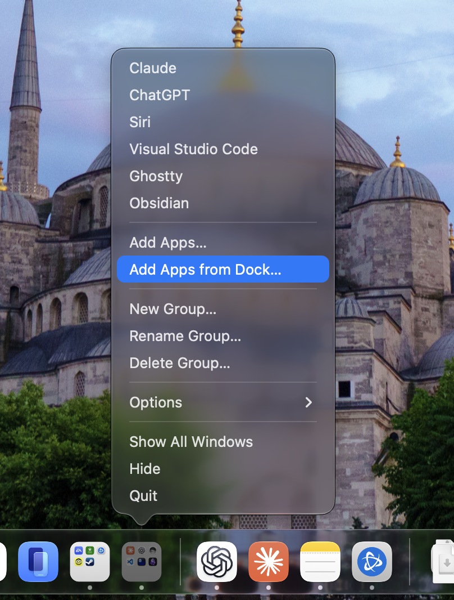

# Foldlet

**iPhone-style app folders for your Mac's Dock.**

<p align="center">
  
</p>

Foldlet lets you gather apps into groups like **Games**, **Work** or **AI + Coding**. Each group sits in your Dock as a single icon showing a tiny 3×3 grid of the apps inside, just like a folder on iPhone.

<p align="center">
  
</p>

Click the group and it pops open right above the Dock. Click an app to launch it.

- **Works with the regular Mac Dock:** there's no Dock replacement, and groups can sit anywhere among your apps.
- **Live mini-icon grid** on every group's Dock icon.
- **Drag** apps in, drag them out, drag to reorder.
- **Clear out your Dock:** move apps that are already pinned there into a group in one step.
- **As many groups as you like.**
- **Small, free and open source:** one Swift file, with no network access, no tracking and no account.

## Install

You need **macOS 13 Ventura or later**, on Apple silicon or Intel.

Open **Terminal** and paste:

```bash
curl -fsSL https://raw.githubusercontent.com/wmtaff/foldlet/main/install.sh | bash
```

The installer builds Foldlet on your Mac (about 20 seconds), creates a group called **Games**, pins it to your Dock and opens it. Then just drop apps onto it.

- **Different name for your first group?** Use `curl -fsSL https://raw.githubusercontent.com/wmtaff/foldlet/main/install.sh | bash -s -- "Work"`
- **First time using developer tools?** macOS will ask to install Apple's free *Command Line Tools*. Click **Install**, wait for it to finish, then run the command again.

<details>
<summary><b>Prefer not to use Terminal?</b></summary>

1. Click the green **Code** button above → **Download ZIP**, then unzip it.
2. Double-click **Install Foldlet.command**.
3. If macOS says it can't verify the developer, right-click the file → **Open** → **Open**.
</details>

> **Why build from source?** Foldlet compiles on your own Mac in seconds, so you can read every line of what you're running, and you won't get the "app from an unidentified developer" warnings that unsigned downloads cause.

## Using Foldlet

| To… | Do this |
|---|---|
| **Open a group** | Click its icon in the Dock. Click an app to launch it. Press **Esc** or click anywhere else to close the group. |
| **Add apps** | Drag apps from Finder or your Applications folder onto the group's Dock icon or onto the open group, or click the **+** tile. |
| **Move apps out of your Dock into a group** | Right-click the group's Dock icon → **Add Apps from Dock…**, tick the apps and keep "Also remove them from the Dock" checked. |
| **Remove an app** | Drag it out of the open group, or right-click it → **Remove from Group**. |
| **Put an app back in the Dock** | Right-click it in the group → **Move to Dock**. |
| **Reorder apps** | Drag them around inside the open group. |
| **New, rename or delete a group** | Right-click any group's Dock icon → **New Group…**, **Rename Group…** or **Delete Group…** |

The extra right-click options appear once a group is running. If you only see the standard Dock options, click the group once first.

### Adding apps

<table>
  <tr>
    <td width="50%" valign="top" align="center">
      <br>
      <sub>Click <b>+</b> in a group to pick apps from your Applications folder or from your Dock.</sub>
    </td>
    <td width="50%" valign="top" align="center">
      <br>
      <sub><b>Add Apps from Dock…</b> lists the apps pinned in your Dock. Tick the ones to move, and they're unpinned from the Dock too.</sub>
    </td>
  </tr>
</table>

### Managing groups

<p align="center">
  
</p>
<p align="center"><sub>Right-click a group in the Dock to launch any of its apps directly, add apps, or create, rename and delete groups.</sub></p>

## Good to know

- **You can't drop a Dock icon directly onto a group.** The Dock treats that as rearranging icons. Use **Add Apps from Dock…** instead, which also unpins the apps for you.
- **Groups stay open after the first click** so they open instantly. Like any open app, a running group shows a dot under its icon and appears in ⌘-Tab.
- **Apps you launch from a group** appear in the Dock while they're running, as usual.
- **When a group isn't running,** the Dock may show a slightly older version of its icon until you click it.

## Update

Run the install command again. It rebuilds Foldlet and updates every group in place, keeping your groups and the apps in them.

## Uninstall

```bash
curl -fsSL https://raw.githubusercontent.com/wmtaff/foldlet/main/uninstall.sh | bash
```

This removes every group from your Dock and moves Foldlet's files to the Trash. Your apps aren't touched.

## How it works

Each group is a tiny app bundle at `~/Applications/Foldlet/<Name>.app`, signed locally on your Mac. Because it's a real app, the Dock lets you pin it anywhere. Groups remember apps by bundle identifier, so they survive app updates and moves, and each group's list is stored in `~/Library/Application Support/Foldlet/`. The Dock icon is drawn live from the icons of the apps inside. Creating, renaming or deleting a group updates your Dock settings (`com.apple.dock`) and restarts the Dock, which takes about a second.

Foldlet never connects to the network.

## Building it yourself

```bash
git clone https://github.com/wmtaff/foldlet.git
cd foldlet
./install.sh
```

All the code is in [`Sources/main.swift`](Sources/main.swift) and uses AppKit only, with no dependencies.

## License

[MIT](LICENSE). Foldlet is an independent project and isn't affiliated with or endorsed by Apple. Mac and macOS are trademarks of Apple Inc.
